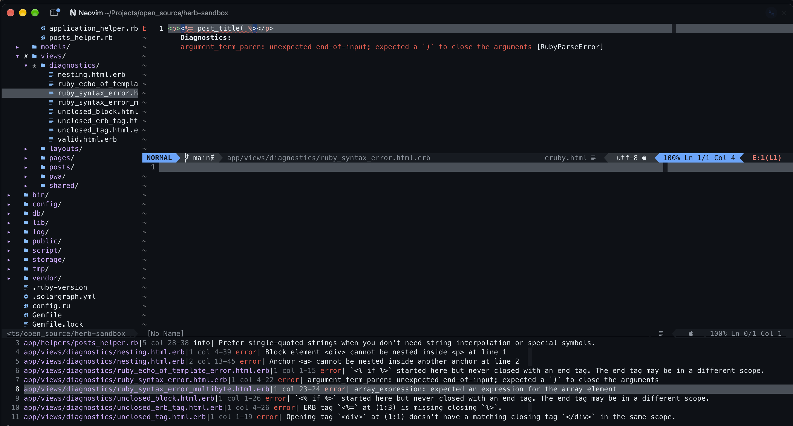

# Solargraph::Herb - A [Solargraph](https://solargraph.org/) plugin for Ruby in Rails ERB views

> [!WARNING]
> Work in progress. The plugin depends on changes that are not released yet.
>
> Open upstream:
> - Solargraph: [#1489](https://github.com/castwide/solargraph/pull/1489) (transformed sources, which this plugin is
>   built on), [#1497](https://github.com/castwide/solargraph/pull/1497) (factory parameters passed as keyword
>   arguments), [#1498](https://github.com/castwide/solargraph/pull/1498) (every assignment of a variable on
>   go-to-definition) and [#1499](https://github.com/castwide/solargraph/pull/1499) (convention pins of files that are
>   not open).
> - solargraph-rails: [#279](https://github.com/iftheshoefritz/solargraph-rails/pull/279) (routes DSL go-to-definition)
>   and [#280](https://github.com/iftheshoefritz/solargraph-rails/pull/280) (route URL helpers).
>
> Stacked on those, waiting for them to merge:
> - Solargraph: [lekemula/solargraph#5](https://github.com/lekemula/solargraph/pull/5) (bind a transformed source to a
>   closure) and [lekemula/solargraph#11](https://github.com/lekemula/solargraph/pull/11) (limit where a factory
>   parameter is visible).
> - solargraph-rails binds a view's Ruby to its controller, helpers, ivars and locals:
>   [#2](https://github.com/lekemula/solargraph-rails/pull/2) (views bound to their controllers),
>   [#3](https://github.com/lekemula/solargraph-rails/pull/3) (route helpers in views),
>   [#4](https://github.com/lekemula/solargraph-rails/pull/4) (partials) and
>   [#5](https://github.com/lekemula/solargraph-rails/pull/5) (every assignment of view variables). Without it, the
>   plugin maps the Ruby of a view, but hover and go-to-definition find little.

This gem brings Solargraph go-to-definition and hover to the Ruby in Rails ERB views, using
[Herb](https://herb-tools.dev) to extract that Ruby from the templates. With the `herb` reporter, Herb's template
errors show as diagnostics too.

## Demo

https://github.com/user-attachments/assets/f29b9367-3205-4517-8cbc-9f0632973f46

## Installation

Add it to your Gemfile. Until those are released, take Solargraph and solargraph-rails from the top of their stacks:

```ruby
group :development do
  gem 'solargraph', github: 'lekemula/solargraph', branch: 'herb-factory-visibility', require: false
  gem 'solargraph-rails', github: 'lekemula/solargraph-rails', branch: 'variable-definitions', require: false
  gem 'solargraph-herb', github: 'lekemula/solargraph-herb', require: false
end
```

Add the plugin to `.solargraph.yml`, and include the views next to the Ruby files. Solargraph only reads `.rb` files by
default, so keep `**/*.rb`:

```yaml
include:
  - "**/*.rb"
  - "app/views/**/*.erb"
plugins:
  - solargraph-rails
  - solargraph-herb
```

Your editor must attach Solargraph to ERB buffers too. Neovim gives `.html.erb` files the compound filetype `eruby.html`,
which matches only when listed exactly:

```lua
vim.lsp.config('solargraph', { filetypes = { 'ruby', 'eruby', 'eruby.html' } })
```

The plugin maps each `*.erb` file under `app/views/` to its Ruby: the code of its ERB tags at their original
positions, with the HTML, the comments and the tag delimiters blanked. Solargraph does not typecheck or format that
code.

### Report Herb parse errors

The plugin registers a `herb` diagnostics reporter. It parses each open view with Herb and reports what Herb finds
wrong with the template, such as an unclosed tag (`MissingClosingTagError`), an ERB tag missing its `%>`
(`UnclosedERBTagError`) or an `<% if %>` without its `<% end %>` (`MissingERBEndTagError`). Add it to the reporters in
`.solargraph.yml`, next to the ones you use:

```yaml
reporters:
  - rubocop
  - require_not_found
  - herb
```

The `herb` reporter also reports Ruby syntax errors inside tags (`RubyParseError`), once each. While the template has
an error of its own, such as an unclosed `<% if %>`, it reports only that error: the Ruby errors it causes are echoes,
and any other Ruby error shows once the template is fixed.

Use `herb:nesting` instead of `herb` to also check HTML nesting, such as a `<div>` inside a `<p>` or an `<a>` inside
another `<a>`.



### Keep RuboCop off `.erb` files

Solargraph versions without a guard in the `rubocop` reporter for mapped sources lint the Ruby mapped from a view,
and report offenses such as trailing whitespace where the HTML was blanked. With those versions, exclude ERB files in
your `.rubocop.yml`:

```yaml
AllCops:
  Exclude:
    - '**/*.erb'
```

RuboCop reads this from the `.rubocop.yml` of the directory Solargraph runs in, usually the project root.

## Development

```sh
bundle install
bundle exec rake # specs and RuboCop
```

The specs in `spec/lsp` (tagged `:lsp`) start a real `solargraph stdio` server over the project in
`spec/fixtures/views_project`, which loads the plugin from its `.solargraph.yml` as a user's project does. To ask a
server what it answers at a position in any project, run
`ruby script/lsp_probe.rb <project_root> <relpath> <line0> <col0>` (`OPEN_FIRST=a.html.erb,b.rb` opens more documents
first).

## License

The gem is available as open source under the terms of the [MIT License](https://opensource.org/licenses/MIT).
